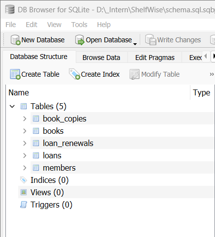
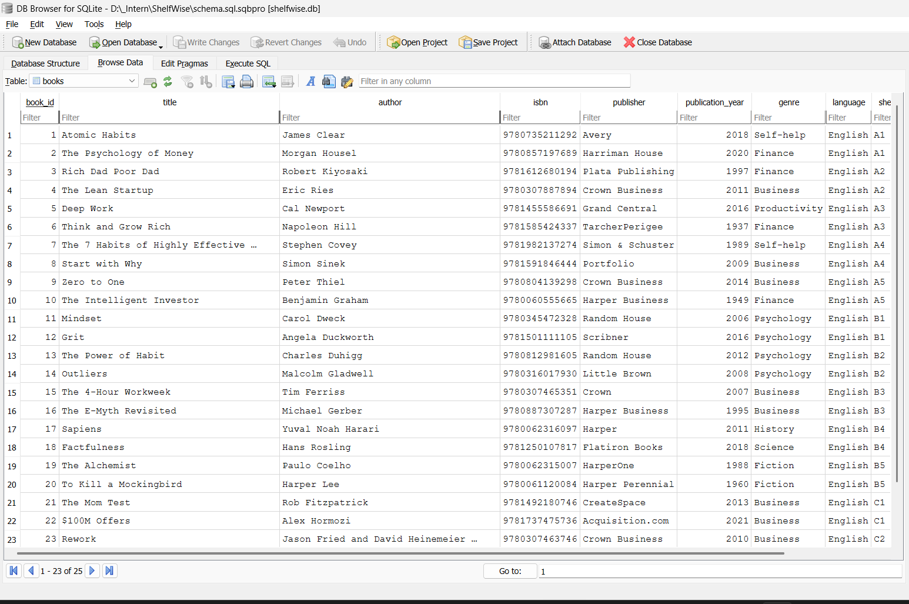
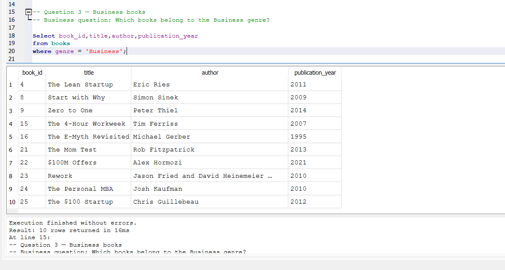

# **ShelfWise – Library Management Database**

### &#x20;**1. Project Overview**

ShelfWise is a library management database project developed using SQLite. It is designed to organize book information, library members, physical book copies, borrowing transactions, and loan renewal records.

The project demonstrates fundamental database concepts, including table creation, primary keys, foreign keys, data insertion, and SQL queries.

### **2. Database Tables**

The database contains five tables:

|Table|Description|
|-|-|
|`books`|Stores book information|
|`members`|Stores library member information|
|`book\_copies`|Tracks individual physical copies of books|
|`loans`|Records book borrowing and return transactions|
|`loan\_renewals`|Stores the history of loan renewals|

### **3. Tools and Technologies**

\- SQLite

\- DB Browser for SQLite

\- SQL

### **4. Project Files**

\- `shelfwise.db` – SQLite database file.

\- `schema.sql` – SQL statements for creating the database tables.

\- `seed.sql` – Sample data inserted into the database.

\- `queries\_week1.sql` – SQL queries developed for Week 1 exercises.

### **5. Sample Data**

The database contains:

\- 25 books

\- 15 members

\- 35 physical book copies

\- 35 borrowing transactions

\- 9 loan renewal records

### **6. How to Run the Project**

1\. Open DB Browser for SQLite.

2\. Open `shelfwise.db`.

3\. Navigate to the Execute SQL tab.

4\. Open and execute `queries\_week1.sql` to explore the sample queries.

\*\*Note:\*\* The database is already populated with sample data. Do not execute `schema.sql` again on this existing database because it contains DROP TABLE statements.

### **7. Learning Objectives**

\- Create relational database tables.

\- Define primary keys and foreign keys.

\- Insert and manage sample data.

\- Retrieve and filter records using SELECT and WHERE.

\- Sort and limit query results using ORDER BY and LIMIT.

\- Search for records using LIKE.

## **8. Database Structure**

The following screenshots demonstrate the database structure, sample book records, and SQL query results from the ShelfWise database.

### **8.1 Database Tables**

### **8.2 Sample Book Data**

### **8.3 SQL Query Results**

